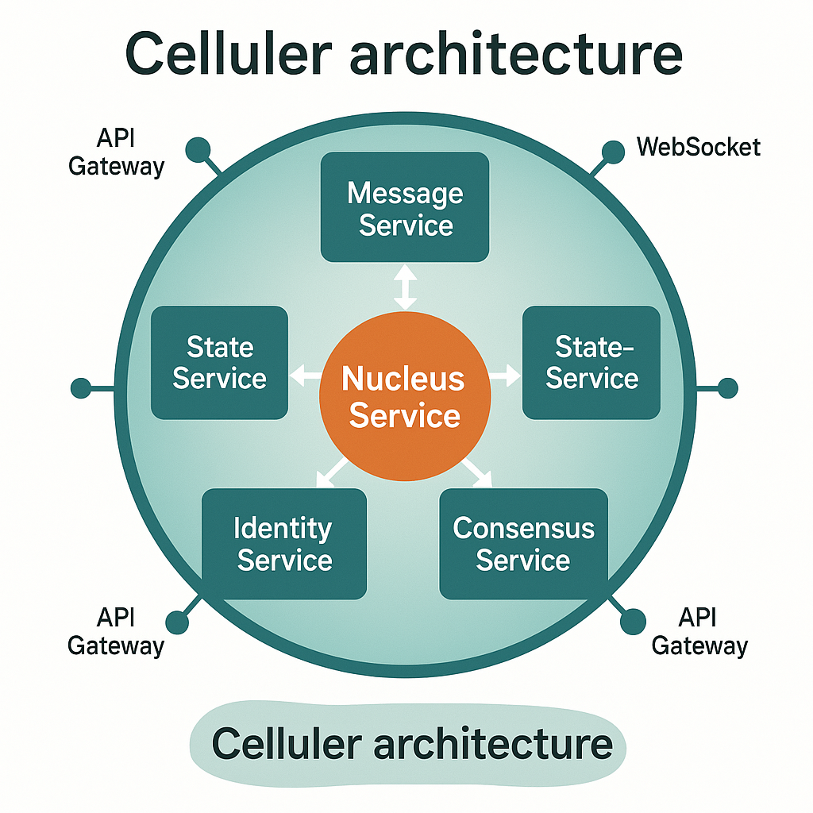

# Architecture Overview

## System Design

Celluler is designed as a distributed system where each node (cell) is both a self-contained unit and part of a larger network. The architecture is built on several key technologies and principles.

### Protocol Layers

| Layer | Name | Scope |
|---|---|---|
| L1 | **NADI** — Network of Agents with Decentralized Identity | Cells, signed journals, decentralized identity and trust, messaging, commons engine (Hashgraph consensus) |
| L2 | **PRANA** — Public Resource Alliance Network Architecture | Economy and governance: PRANA token, quadratic funding and voting, co-op and private commons |
| L3 | **BUDDHI** — Builder-owned, Universally Distributed, Democratically Hosted Intelligence | AI commons: compute, data, model and agent commons |

A service may depend only on services in its own layer or below. Within NADI, the NucleusService depends on nothing and the MessageService depends only on the Nucleus; every other service plugs in by registering record types with the Nucleus and message protocols with the MessageService. The NADI foundation is specified in detail in [NADI Journal, Identity & Messaging](nadi-journal-identity.md).

### Core Technologies

1. **Moleculer Framework**
   - Internal service architecture
   - Service discovery and communication
   - Load balancing and fault tolerance
   - Metrics and monitoring

2. **Hypercore Protocol**
   - Distributed append-only logs for message journals
   - Cryptographic message history and verification
   - Peer-to-peer data sharing
   - Each cell's public journal holds only commitments (hashes and Merkle roots); private data lives in an encrypted, non-replicated store
   - Identity verification through committed social interaction history

3. **Consensus Algorithm (Hashgraph)**
   - Byzantine fault tolerance
   - Fair ordering
   - Fast finality
   - Secure propagation

## Cell Architecture

A cell is implemented as a cluster of microservices. The NucleusService acts as the cell's memory manager: it owns the cell's keys, its public journal and its private store, and services record data through it rather than writing cores directly. The services work together to provide the cell's functionality while maintaining data integrity and security.




### Core Services

1. **NucleusService** (NADI)
   - The cell's memory manager; depends on no other service
   - Holds the root seed and derives all cell keys; the journal's public key is the cell ID
   - Owns the journal, which is the cell's event chain: every block is an event created by the Nucleus, carrying public records (keys, public messages such as votes, revealed receipts) and a commitment root over private records
   - Keeps full records in an encrypted, mutable private store and commits their hashes in each event's commitment root
   - Never deletes; produces proofs about any committed record (redaction is an explicit, recorded exception)

2. **MessageService** (NADI)
   - Depends only on the NucleusService
   - Reliable delivery over pairwise links: sender-owned link cores, an inbox, signed delivery receipts, offline delivery through blind replicas
   - Multicast through per-sender topic cores
   - Defines no message types: services register handlers for their own protocols (e.g. an AuthService registers `auth/1`)
   - Records sends, receipts and inbox entries through the Nucleus

3. **StateService**
   - Maintains local state
   - Syncs with global state through Hashgraph consensus
   - Handles state transitions
   - Manages state verification
   - Stores state history in a Hypercore journal

4. **IdentityService**
   - Manages cell identity verification
   - Maintains trust networks
   - Handles social interaction proofs
   - Implements reputation systems
   - Stores identity and trust data in a Hypercore journal

5. **ConsensusService** (NADI commons engine; see [proposal](nadi-consensus.md))
   - Runs Hashgraph over cells' journals in protocol-assigned clusters (~100 cells), nested into hyper-clusters through representatives
   - Gives every event a global, causally consistent order across the network
   - Finalizes checkpoints signed by > 2/3 of active weight; participation stats become identity evidence
   - Clusters are network topology, not social organization: cells message anyone, and commons sit in PRANA

### Service Coordination

Services within a cell coordinate through:
- NucleusService as the central coordinator
- Moleculer service bus for internal communication
- Shared read access to Hypercore journals (write access through NucleusService)
- Participation in the Hashgraph consensus network
- Event-driven architecture for state synchronization

### Data Storage

Each cell has two kinds of storage, both managed by the NucleusService:
- **Journal**: one replicated Hypercore per cell holding its events (genesis, syncs, public records such as keys and public messages, revealed receipts), each with a commitment root over private records. Permanent and public.
- **Private store**: an encrypted, mutable local store holding full records, message bodies and key material. Backed up as encrypted, erasure-coded shards across custodians.
- **Link and topic cores**: sender-owned cores that carry messages to counterparties and subscribers.

Owners never delete their own data (Hypercore replicas cannot be recalled anyway); data held for other cells is kept according to explicit storage duties. See [NADI spec §4](nadi-journal-identity.md#4-storage-model).

## Messaging Protocol

The MessageService defines syntax only; services define the semantics of their own protocols. Full detail: [NADI spec §9](nadi-journal-identity.md#9-message-service).

### Message Structure

```typescript
interface Message {
    v: 1;
    id: Bytes32;          // H(from ‖ link ‖ index), used for dedupe
    from: Bytes32;        // sender cell ID (journal public key)
    to: Bytes32 | Topic;  // a cell, or a topic for multicast
    protocol: string;     // "<service>/<version>", e.g. "auth/1", registered by that service
    ts: number;
    body: Uint8Array;     // opaque; the link or topic core is encrypted
    sig: Bytes64;         // sender's attested Ed25519 signing key over all fields
}
```

There is no fixed `MessageType` enum. Former types such as AUTH, TX or QUERY become protocols owned by the services that handle them (AuthService, a PRANA ledger service, a BUDDHI data service, and so on).

### Message Flow

1. **Linking**: two cells agree to communicate and exchange the keys of their sender-owned link cores, encrypted with a shared link secret.
2. **Sending**: the sender appends the message to its link core (or topic core); the block index is the per-link sequence number.
3. **Delivery**: live Hypercore replication while both are online; on startup the receiver pulls new blocks from every inbound link; blind replicas cover a sender that is offline.
4. **Receiving**: the receiver verifies the signature, copies the body into its private store, appends an inbox entry, acknowledges in its own link core, and dispatches to the handler registered for `protocol`.
5. **Guarantees**: no loss while any copy of the sender's core survives; exactly-once inbox delivery; FIFO per sender; global order from consensus.

## Network Architecture

### Cell-to-Cell Communication

1. **Direct P2P Connections**
   - Hyperswarm connections (Noise-encrypted; the remote swarm key must be attested in the sender's journal)
   - Message routing and delivery
   - Connection management and health monitoring

2. **Consensus Network**
   - Hashgraph-based event propagation
   - Byzantine fault tolerance
   - Fair ordering of events
   - State synchronization

3. **Discovery and Bootstrap**
   - Initial peer discovery
   - Bootstrap node configuration
   - Network self-organization
   - Dynamic peer management

### Security Model

1. **Identity Verification**
   - Tiered verification: key possession (T1), continuity via consensus timestamps (T2), relationship edges (T3a), cluster participation attestations (T3b), selective claims with Merkle proofs (T4)
   - Journal forks (a cloned key) are self-contained proofs of compromise
   - Hybrid edge privacy: relationships are committed privately by default; a cell may reveal an edge, or a protocol may require one, and public reveals are co-signed by both cells
   - Trust network validation
   - Reputation-based access control

2. **Data Protection**
   - End-to-end encryption
   - Access control lists
   - Data integrity verification
   - Secure key management

## Deployment Architecture

### Single Cell Deployment

1. **Service Configuration**
   - Moleculer service registry
   - Hypercore storage configuration
   - Consensus network settings
   - Security parameters

2. **Resource Management**
   - CPU and memory allocation
   - Storage requirements
   - Network bandwidth
   - Service scaling

### Multi-Cell Deployment

1. **Network Topology**
   - Cell interconnection patterns
   - Consensus network structure
   - Message routing optimization
   - Load balancing

2. **Resource Distribution**
   - Distributed storage
   - Compute resource allocation
   - Network bandwidth management
   - Service replication

## Monitoring and Observability

1. **Service Metrics**
   - Moleculer service health
   - Message throughput
   - Consensus participation
   - Resource utilization

2. **Network Metrics**
   - P2P connection status
   - Message delivery rates
   - Consensus performance
   - Network topology

3. **Security Metrics**
   - Identity verification rates
   - Message validation success
   - Access control events
   - Security incidents

## Market Architecture (PRANA, L2)

### Market Types

1. **Global Market (PRANA)**
   - Universal participation
   - Common token balance
   - Base currency for all transactions
   - Global state consensus

2. **Resource Markets**
   - Compute resource trading
   - Data storage trading
   - Resource allocation
   - Price discovery

3. **Specialized Markets**
   - AI model training
   - Data sharing
   - Service provision
   - Custom applications

### Market Mechanics

1. **Cooperative Games**
   - Trust-based interactions
   - Resource pooling
   - Profit sharing
   - Reputation systems

2. **Resource Allocation**
   - Dynamic pricing
   - Load balancing
   - Quality of service
   - Fair distribution

3. **Token Economics**
   - PRANA as base currency
   - Market-specific tokens
   - Cross-market trading
   - Value transfer

## Security Architecture

### Data Security
- End-to-end encryption
- Message signing
- Access control
- Data verification

### Market Security
- Byzantine fault tolerance
- Fair ordering
- Transaction verification
- State consistency

## Scalability

The system is designed to scale through:

1. **Horizontal Scaling**
   - Multiple cells
   - Distributed markets
   - Resource sharing
   - Load balancing

2. **Vertical Scaling**
   - Resource optimization
   - Performance tuning
   - Caching strategies
   - State management

## Deployment Options

Cells can be deployed in various configurations:

1. **Single Machine**
   - All services on one machine
   - Good for development and testing

2. **Cluster**
   - Services distributed across machines
   - Better for production workloads

3. **Hybrid**
   - Mix of single and clustered deployments
   - Flexible resource allocation

## Future Considerations

1. **Planned Features**
   - Sharding support
   - Cross-chain compatibility
   - Advanced AI model distribution
   - Enhanced security features

2. **Research Areas**
   - Optimizing consensus performance
   - Improving data distribution
   - Enhancing AI model collaboration
   - Advanced security mechanisms 